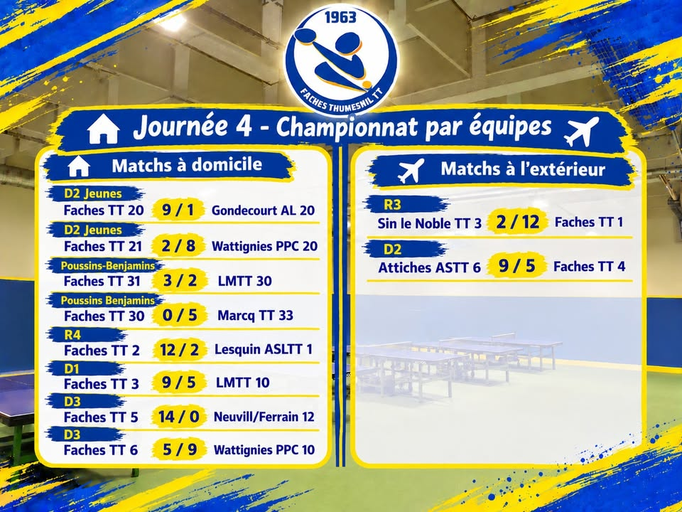
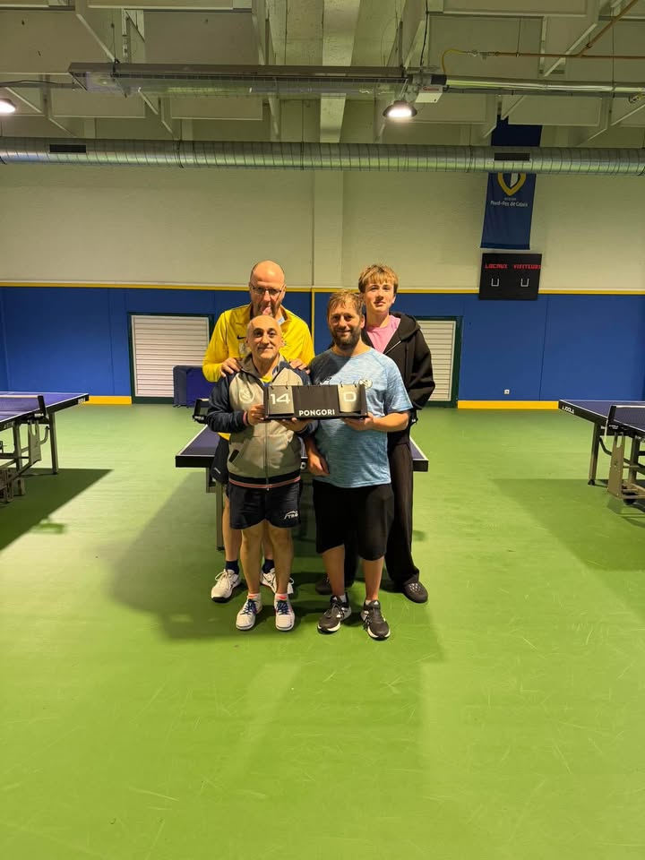
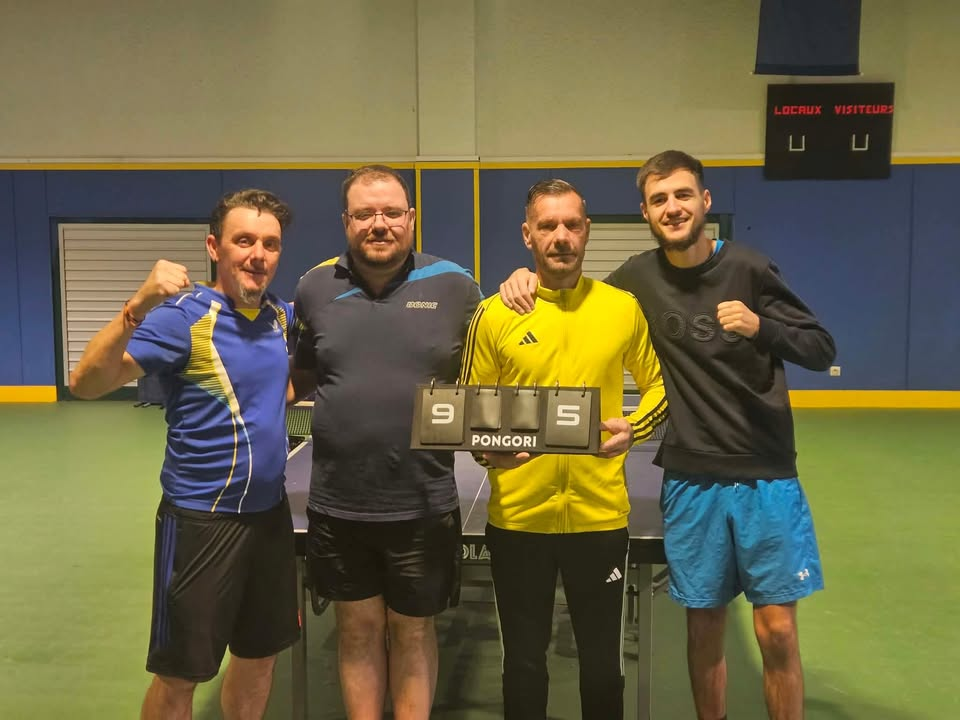

Après quelques semaines de vacances, nos joueurs ont retrouvé la compétition ce week-end avec la 4e journée du championnat par équipes :  

🔵 Équipes jeunes :  

✅ Faches TT 20 : 9/1 Gondecourt AL 20 (D2 Jeunes)  

La série d'invincibilité continue pour nos jeunes qui s'imposent largement face à Gondecourt. Félicitations à Yanis, Jibril et Gautier pour ce beau résultat.  

❎ Faches TT 21 : 2/8 Wattignies PPC 30 (D2 Jeunes)  

Face à une équipe plus forte, nos jeunes n'auront pas pu faire grand-chose. Maxence ramène les deux points pour Faches.  

❎ Faches TT 30 : 0/5 Marcq TT 33 (Poussins/Benjamins)  

L'apprentissage de la compétition continue pour nos jeunes. Malgré de belles choses montrées à la table, ces derniers s'inclinent face à Marcq.  

✅ Faches TT 31 : 3/2 LMTT 30 (Poussins/Benjamins)  

Belle victoire de Maël et Abel face aux jeunes de Lille. Le double est remporté et Abel tout comme Maël remportent un simple. Bravo à eux deux.  

🟡 Équipes adultes :   

✅ Sin le Noble TT 1 : 2/12 Faches TT 1 (R3)  

Notre équipe fanion poursuit sur sa lancée et s'impose largement face à Sin le Noble. Thibault et Benjamin font le sans-faute, tandis que François rapporte deux points tout comme Corentin. Enfin, les deux doubles sont remportés. Grâce à cette victoire, la montée en R2 est quasiment assurée.  

✅ Faches TT 2 : 12/2 Lesquin ASLTT 1 (R4)  

Première victoire pour notre R4 qui lui permet de se relancer dans la course au maintien. Romain pour son retour à la compétition repart avec deux victoires et gagne le double avec Noa qui remporte aussi deux simples. Enfin, Maxime et Thomas réalisent le sans-faute de leur côté.  

✅ Faches TT 3 : 9/5 LMTT 10 (D1)  

Après une défaite lors de la dernière journée, notre équipe D1 retrouve la victoire contre Lille. Théo réalise le sans-faute en remportant ses trois simples ainsi que le double. Le second double est également gagné par nos joueurs. Enfin, Mickael rapporte deux points, Valentin ramène un autre point tout comme Mathieu.   

❎ Attiches ASTT 6 : 9/5 Faches TT 4 (D2)  

Face à une équipe d'Attiches plus forte, notre équipe n°4 aura tout tenté, mais s'incline malheureusement encore une fois. Bravo à Julien qui réalise le 3/3 avec de belles perfs au passage. Nathan remporte un simple en faisant également une belle perf. Enfin, Ghislain rapporte le dernier point.  

✅ Faches TT 5 : 14/0 Neuvill/Ferrain 12 (D3)  

Journée parfaite pour l'équipe 5 qui ne laisse échapper aucun point. Bravo à Ezio, Seb, Mich et Angelo pour cette belle victoire !  

❎ Faches TT 6 : 5/9 Wattignies PPC 10 (D3)  

Au terme d'un match serré, l'équipe n°6 s'incline face à Wattignies. Un grand merci à Yanis qui est venu dépanner l'équipe en dernière minute et repart avec trois belles victoires ! Marlène ramène les deux autres points pour l'équipe.   

Retour à l'entraînement dès cette semaine pour préparer le 2ème tour du critérium fédéral qui aura lieu la semaine prochaine et la 5ème journée du championnat qui se déroulera lors du week-end du 21/22 novembre. Encore bravo à tous nos joueurs !   

#fachesthumesnil #tennisdetable  

