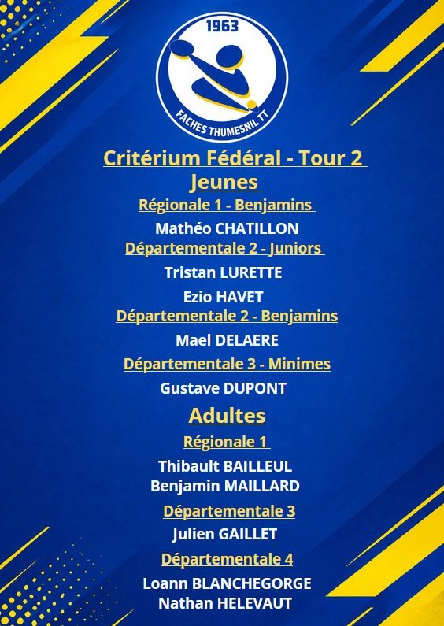

Ce week-end se tiendra le 2e tour du critérium fédéral où plusieurs joueurs du club (jeunes et adultes) sont engagés. Par ailleurs, comme lors du 1er tour, nous serons heureux d'accueillir une nouvelle fois demain matin la D4 Seniors pour ce 2e tour.   

Jeunes :  

🔵 Mathéo - Régionale 1 Benjamins (St-Quentin)  
🟡 Ezio et Tristan - Départementale 2 Juniors (Santes)  
🔵 Mael - Départementale 2 Benjamins (Flines-lez-Raches)  
🟡 Gustave - Départementale 3 Minimes (Villeneuve d'Ascq)  

Adultes :  

🔵 Thibault et Benjamin - Régionale 1 (Isbergues)  
🟡 Julien - Départementale 3 (Flines-lez-Raches)  
🔵 Loann et Nathan - Départementale 4 (Ville de Faches-Thumesnil)  

Bonne chance à l'ensemble des joueurs engagés ! Allez Faches !  

