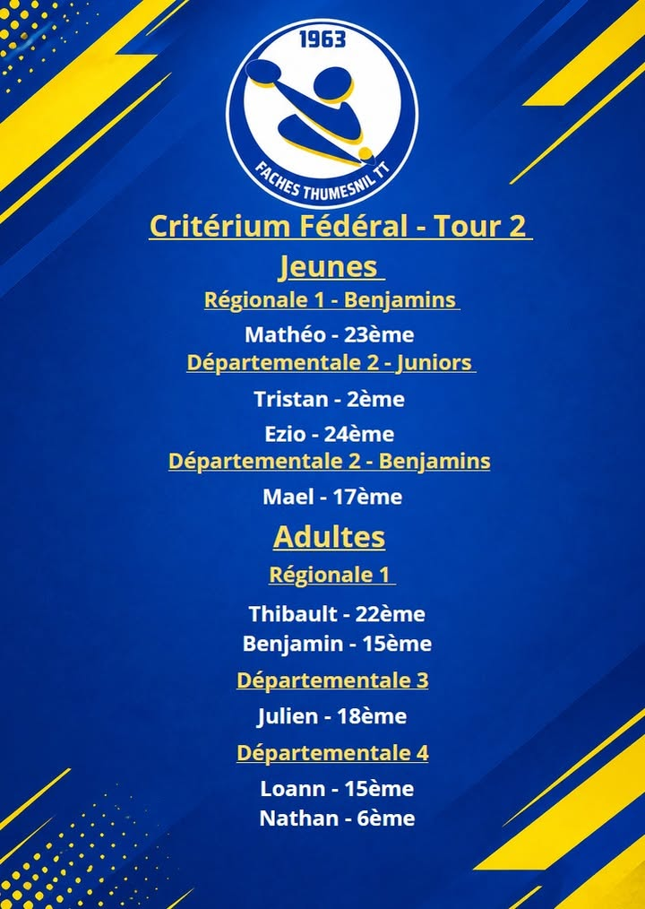
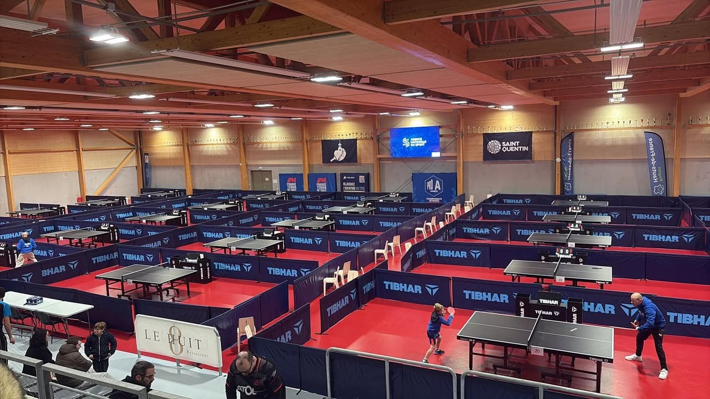
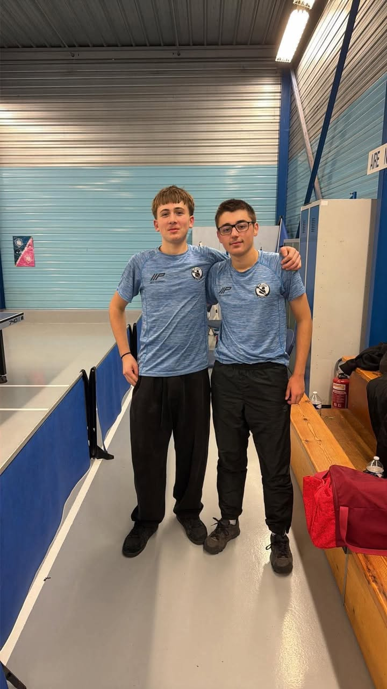
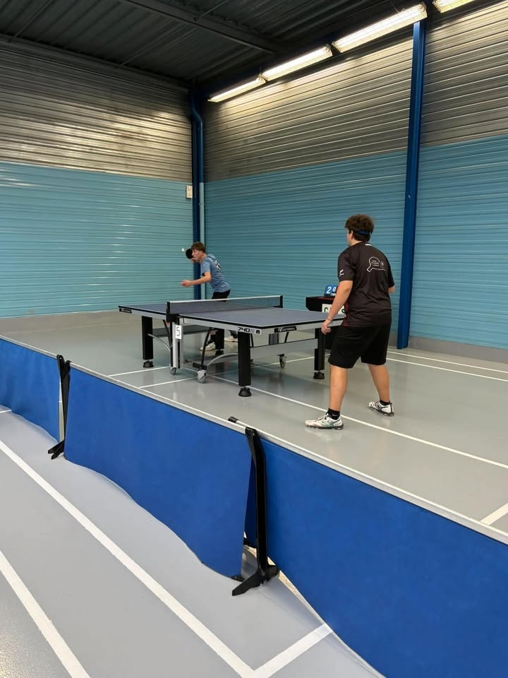
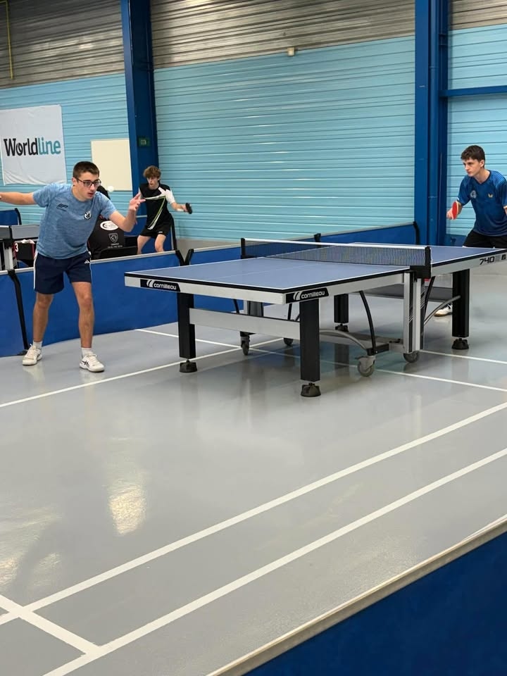
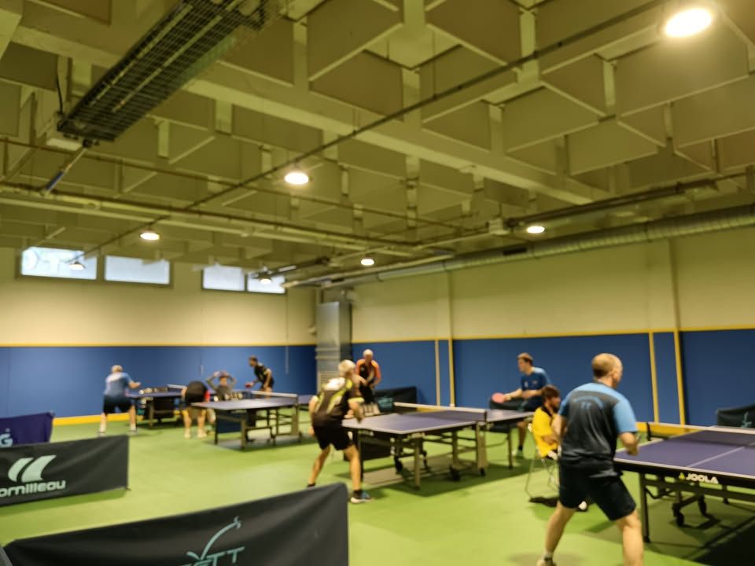
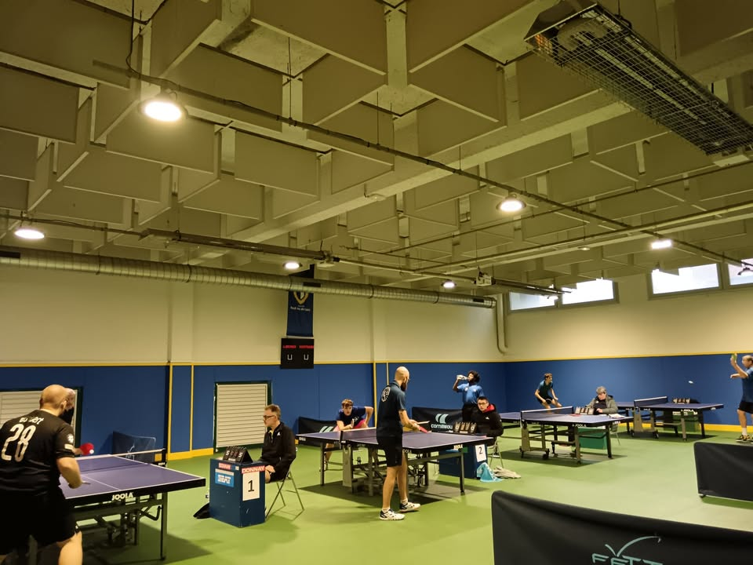
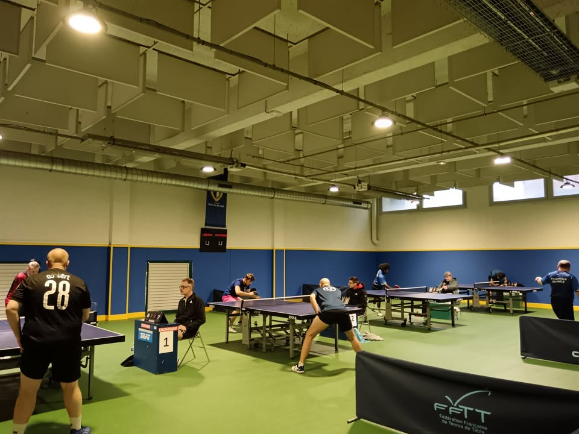

Plusieurs joueurs du club étaient engagés ce week-end pour le 2ème tour du critérium fédéral. Après un premier tour marqué par des résultats globalement positifs, ce deuxième tour a été un peu plus compliqué pour certains de nos joueurs.   

Jeunes :   

🔵 Suite à un premier tour encourageant, Mathéo en régionale 1 termine cette fois-ci à l'avant-dernière place synonyme malheureusement de descente en départementale. Néanmoins, il y a du positif à retenir et il ne fait aucun doute que Mathéo repartira de l'avant lors du 3e tour !   
🟡 Chez les juniors (départementale 2), Tristan qui a terminé 4ème au premier tour se classe lors de ce 2nd tour à la 2e place, ce qui lui permettra de monter en départementale 1. À l’opposé du classement, on retrouve Ezio qui termine dernier et descendra en départementale 3.   
🔵 Mael qui découvre le critérium fédéral termine à la 17ème place. L'apprentissage de la compétition continue et l'entraînement finira par payer !   

Adultes :   

🟡 Chez les adultes, Thibault termine à la 22ème place en R1 et Benjamin se classe 15ème.   
🔵 Julien parvient encore une fois à se maintenir en départementale 3 en terminant à la 18ème place !   
🟡 Enfin, à domicile, Nathan réalise de nouveau un beau tour avec et se hisse à la 6ème place du classement. Loann après un très bon premier tour a connu un 2nd tour plus compliqué et termine à la 15ème place   

Le club tient à féliciter l'ensemble de ses joueurs engagés au cours de ce 2ème tour ! Le 3ème et avant dernier tour du CF aura lieu le week-end du 30 et 31 janvier. D'ici-là, retour à l'entraînement dès demain pour préparer la prochaine journée de championnat par équipes qui aura lieu ce week-end.  

