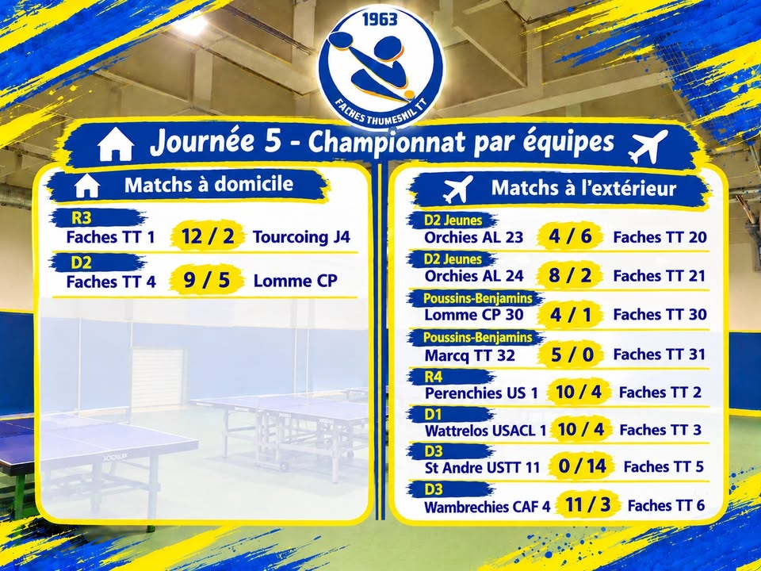

Nos équipes ont retrouvé la compétition ce week-end avec la 5e journée du championnat par équipes. À domicile, nos deux équipes ont remporté leurs matchs et notamment la D2 qui s'impose pour la première fois de la saison et se relance dans la course au maintien. Quant à notre équipe fanion, elle reste toujours invaincue et se dirige tout droit vers la montée en Régionale 2 !   

Du côté des jeunes, on retiendra la belle victoire de l'équipe 20 à Orchies qui n'a toujours pas perdu un match de la phase ! Il y a également beaucoup de positif à retenir chez les autres équipes jeunes avec de nombreux joueurs qui continuent de découvrir la compétition.   

Enfin, chez le reste des équipes adultes, la R4 n'a pas réussi à trouver la solution face à Pérenchies. Le match du maintien se jouera contre Ennetières à la prochaine journée ! Du côté de la départementale 1, un week-end également compliqué avec ce déplacement à Wattrelos. À retenir néanmoins, la belle victoire de la D3, 14/0 face à St-Andre !   

Jeunes :   

✅ Orchies AL 23 : 4/6 Faches TT 20 (D2 Jeunes)  
❎ Orchies AL 24 : 8/2 Faches TT 21 (D2 Jeunes)  
❎ Lomme CP 30 : 4/1 Faches TT 30 (Poussins/Benjamins)  
❎ Marcq TT 32 5/0 Faches TT 31 (Poussins/Benjamins)  

Adultes   

✅ Faches TT 1 : 12/2 Tourcoing JG 4  
❎ Pérenchies US 1 10/4 Faches TT 2  
❎ Wattrelos USACL : 10/4 Faches TT 3   
✅ Faches TT 4 : 9/5 Lomme CP 7  
✅ St Andre USTT 11 : 0/14 Faches TT 5   
❎ Wambrechies ACF 4 : 11/3 Faches TT 6   

Retour à l'entraînement dès demain soir pour nos joueurs afin de préparer au mieux la prochaine journée du championnat qui aura lieu dans deux semaines !  

